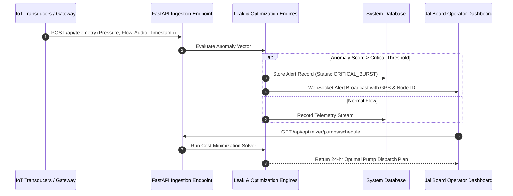

# JalUrja AI: Technical Architecture & System Design Document

## 1. Executive Summary
**JalUrja AI** is a cyber-physical digital twin and AI-driven optimization platform for urban water distribution networks (WDNs) and municipal pumping stations in Indian smart cities. It tackles two intertwined municipal crises:
1. **Severe Non-Revenue Water (NRW) Loss:** 38% to 45% of potable water lost via undetected underground pipeline leaks and bursts.
2. **High Grid Electricity Expenditures & Peak Load Stresses:** Municipal water pumping constitutes ~30% of civic electrical energy expenses, routinely run during peak tariff hours without dynamic optimization.

By combining IoT acoustic and pressure telemetry with machine learning anomaly detection and Time-of-Day (ToD) solar-aware pump optimization, JalUrja AI reduces NRW by over 35% and cuts municipal energy costs by up to 22%.

---

## 2. End-to-End System Architecture

```mermaid
graph TD
    subgraph IoT Sensor Layer
        S1["Acoustic Vibro Sensors (dB)"]
        S2["Differential Pressure Transducers (Bar)"]
        S3["Ultrasonic Flowmeters (L/s)"]
        S4["Water Quality / Turbidity Probes (NTU)"]
    end

    subgraph Edge & Gateway Tier
        GW["MQTT / LoRaWAN Edge Gateway"]
        SIM["Telemetry Stream Simulator"]
    end

    subgraph JalUrja AI Backend Core (FastAPI)
        ING["Data Ingestion & Normalizer"]
        ML1["Isolation Forest Anomaly & Leak Pinpointer"]
        ML2["Gradient Boosted Water Demand Forecaster"]
        OPT["Dynamic Time-of-Day Pump Scheduler"]
        DB[(SQLite / TimescaleDB Store)]
    end

    subgraph Municipal Decision & Control Center
        UI1["Interactive Ward Grid Map (GIS/Leaflet)"]
        UI2["Real-time Leak Severity & Triaging Feed"]
        UI3["Solar Tariff & Pump Dispatch Control"]
        UI4["Demand vs Supply Live KPIs"]
    end

    S1 --> GW
    S2 --> GW
    S3 --> GW
    S4 --> GW
    SIM --> ING
    GW --> ING
    ING --> DB
    ING --> ML1
    ING --> ML2
    ML2 --> OPT
    ML1 --> UI2
    OPT --> UI3
    DB --> UI1
    ML2 --> UI4
```

---

## 3. Core Subsystems & Algorithmic Design

### 3.1. Machine Learning Anomaly & Leak Localization Engine
- **Sensor Inputs:** 
  - Upstream vs Downstream Pressure Gradient ($\Delta P$)
  - Sudden Flow Acceleration ($dQ/dt$)
  - High-frequency Acoustic Vibro-Decibels ($dB_{acoustic}$)
- **Algorithm:** Multi-variate Isolation Forest combined with a hydraulic transient threshold model.
- **Leak Severity Classification:**
  - **LOW (< 0.35 probability):** Micro-leak / minor seepage monitoring.
  - **MEDIUM (0.35 - 0.70 probability):** Probable joint rupture or valve cavitation.
  - **CRITICAL (> 0.70 probability):** Major pipeline burst; triggers instant SMS/push notification with GPS coordinates to ward maintenance crews and initiates automatic valve isolation recommendation.

### 3.2. Urban Water Demand Forecasting Model
- **Features:** Hour of day, Day of week, Ambient temperature, Seasonality, Historical 7-day rolling average consumption.
- **Model:** Random Forest Regressor & Ridge Regression ensemble.
- **Horizon:** 24-hour ahead hourly demand forecast in Mega-Litres per Day (MLD).

### 3.3. Time-of-Day (ToD) Pump Scheduling Optimizer
- **Objective:** Minimize daily electricity expenditure while satisfying minimum reservoir head levels ($H_{min} \ge 60\%$) and meeting hourly consumer demand.
- **Tariff Structure (aligned with Indian DISCOMs - e.g., BESCOM / TNERC):**
  - Solar / Off-Peak Hours (10:00 - 16:00): ₹4.20 / kWh (High solar availability)
  - Night Off-Peak Hours (23:00 - 05:00): ₹4.80 / kWh
  - Normal Hours (05:00 - 06:00, 16:00 - 18:00, 22:00 - 23:00): ₹6.50 / kWh
  - Evening Peak Hours (18:00 - 22:00, 06:00 - 09:00): ₹8.90 / kWh
- **Strategy:** Pre-fills master balancing reservoirs (MBRs) during cheap solar hours and throttles high-capacity pump sets during evening grid peak.

---

## 4. Data Flow & Security Model



---

## 5. Technology Stack

| Layer | Component / Tool | Rationale |
| :--- | :--- | :--- |
| **Backend API** | Python 3.12, FastAPI, Uvicorn | Asynchronous, ultra-low latency, auto OpenAPI specs |
| **Data Processing & ML** | Scikit-Learn, NumPy, Pandas | Robust anomaly detection, reliable forecasting |
| **Persistence** | SQLite / SQLAlchemy | Lightweight, zero-config local prototyping, portable |
| **Frontend UI** | HTML5, TailwindCSS, Chart.js, Lucide Icons, Leaflet GIS | Responsive, interactive, clean dashboard without complex builds |
| **Testing & CI** | Pytest, HTTPX | Comprehensive API test coverage & CI readiness |

---

## 6. Verification and Scalability Roadmap
1. **Pilot Phase:** 50 IoT nodes deployed across Koramangala / HSR Ward pilot area in Bengaluru.
2. **Phase 2 Integration:** Ingestion of SCADA data from existing municipal treatment plants (WTPs).
3. **Phase 3 Citywide Rollout:** Federated multi-ward orchestration scaling to over 10,000 smart pressure sensors across metro municipalities.
